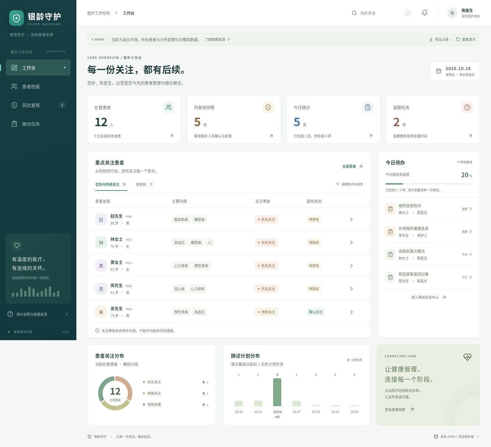

# 银龄守护

老年共病患者健康分析与连续随访演示项目。

- 根目录的 Python 文件：原有离线特征工程、健康画像、共病分析、再入院预测及检验时序建模。
- [`frontend/`](frontend/README.md)：新增医护工作台，使用 React、TypeScript、ECharts、本地 JSON / CSV 和浏览器存储，不需要数据库或后端。

## 启动前端

```bash
cd frontend
npm ci
npm run dev
```

包含工作台、患者档案、风险复核、随访任务，以及导出与重置功能。

支持两种独立模式：

- 示例模式：内置明确标注的虚拟患者与模拟结果。
- 真实历史数据模式：点击顶部「导入真实历史数据」，选择患者宽表和再入院评分 CSV。本地关联真实字段、检验汇总与历史模型输出，保留重复次数及同日差异，不补造缺失记录。文件只在浏览器内存读取，刷新后重新选择；本地流程记录按文件指纹隔离保存。

原始医疗数据不提交到 GitHub。界面不运行 Python 模型，也不代表完成了临床验证。

下方截图来自示例模式，不包含真实患者记录。

详细启动、演示流程、数据格式与测试说明见 [前端使用说明](frontend/README.md)。


