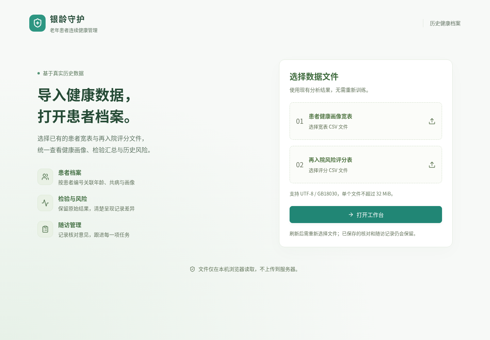

# 银龄守护

老年患者历史健康档案、风险评估与连续随访管理。

- 根目录 Python 文件：原有离线特征工程和模型分析。
- [`frontend/`](frontend/README.md)：真实历史数据工作台，只读取用户选择的 CSV，不内置模拟患者或评分，不需要数据库与后端。

## 启动前端

从仓库根目录进入前端，再执行安装与启动：

```powershell
cd frontend
npm ci
npm run dev
```

在页面选择患者宽表和再入院评分 CSV，点击「打开工作台」。缺失字段留空，重复与差异记录保留，核对和随访记录保存在当前浏览器。

数据口径、启动与测试说明见 [前端使用说明](frontend/README.md)。


